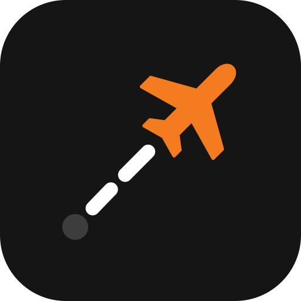

<p align="center">
  
</p>

<h1 align="center">TRAVLR</h1>

<p align="center">
  Selbst gehosteter Flug-Agent: findet die <b>insgesamt günstigsten Flüge</b> (inkl. Anreise und Parken),<br>
  überwacht Preise und meldet sich per Push, wenn es wirklich günstig wird.
</p>

<p align="center">
  
  
  
  
  
</p>

> „Im Mai zwei Wochen New York, Hauptsache billig, Umsteigen egal“

Ein Claude-Agent plant mehrere Suchen über Google Flights, Duffel und Prämienflüge, rechnet Anreise und Parken ein und empfiehlt die besten Optionen mit Begründung. Gebucht wird nicht automatisch: Du bekommst Links und eine kopierbare Anfrage fürs Reisebüro.

## Was TRAVLR kann

| Bereich | Was passiert |
|---|---|
| **Suche** | Claude plant mehrere Suchen, fragt alle Quellen ab und empfiehlt die besten 1–4 Optionen mit Begründung, Link und kopierbarer Reisebüro-Anfrage |
| **Umkreis-Start** | Wohnort eintragen: Die Fahrzeit schlägt die Flughäfen vor (z. B. ab Köln bis 2 h: CGN, DUS, DTM, Weeze, Maastricht, Eindhoven …), einzelne weiter entfernte wie Frankfurt oder Amsterdam hakst du zusätzlich an. Suche und Alarme nutzen genau diese Liste, inkl. grober Anreisekosten |
| **Preisalarme** | Strecke + Zeitfenster + Reisedauer + Schwelle („New York unter 300 €“). Wird regelmäßig zu wechselnden Daten geprüft, mit Preisverlauf und Googles Preisniveau (niedrig/typisch/hoch) |
| **Deal-Radar** | „Wohin komme ich ab meinem Umkreis unter X €?“ über Google Travel Explore, optional nur bestimmte Länder (z. B. USA, Japan) |
| **Push** | Alarme und Wochen-Digest per [ntfy](https://ntfy.sh) aufs Handy, ein Tipp öffnet den Flug |
| **Community-Digest** | Einmal pro Woche: Deal-Seiten und Vielflieger-Foren (RSS) auswerten; passende Deals und neue Tricks. Übernommene Tipps kennt der Such-Agent dann als Hintergrundwissen |
| **Anreise & Parken** | Jeder Flug zeigt im Kleingedruckten die Anreise ab Heimatflughafen: Taxi (z. B. zum nächsten Flughafen) oder Auto + Parkhaus für die Reisedauer (Schätzwerte für vorab gebuchtes Parken, je Flughafen überschreibbar). Empfehlungen und Alarme vergleichen über den **Gesamtpreis** |
| **Meilen** | Kontostände (Amex MR, Miles & More, BA Club …), Amex-Transferkurse, Prämienflüge (seats.aero) mit Gegenwert in Cent pro Meile |
| **Faktoren** | Priorität Preis/Komfort, Gepäck, Umstiege, Reisezeit, Umstiegszeiten, Airlines ausschließen, getrennte Tickets, Positionierung, andere Märkte |

## Spar-Strategien des Agenten

Flexible Daten, alle Flughäfen im Umkreis, Positionierung (Langstrecke ab AMS/BRU/CPH … plus Zubringer), zwei One-Ways statt Hin/Rück, Gabelflüge, anderer Markt (als Experiment, inkl. Auslandsentgelt der Karte), Gesamtkosten statt Lockpreis, Meilen bei hohen Barpreisen.

### Mythen-Check

| Behauptung | Stand der Belege |
|---|---|
| „Mit Android/Windows ist es billiger als mit iPhone/Mac“ | **Kaum belegt.** Die Northeastern-Studie (2014) fand nur vereinzelte, kleine Effekte, vor allem bei Hotels; eher Sortierung als Preis. Für Flüge kein systematischer Nachweis |
| „Inkognito/Cookies löschen, sonst steigt der Preis“ | **Kaum belegt** (Consumer-Reports-Test mit neun Portalen). Eingeloggte Nutzer sahen eher niedrigere Preise |
| Ticket-Kombinationen, Positionierung, flexible Daten | **Wirkt oft deutlich**. Kern von TRAVLR |
| Point of Sale / Währung | **manchmal**; das Auslandsentgelt (Amex ca. 2 %) frisst einen Teil |
| Reisebüro statt Direktbuchung | Lufthansa Group: **ca. 19 € Aufschlag pro Ticket** bei GDS-Buchung (Stand 2026). Nach NDC-Buchung fragen |

## Datenquellen

| Quelle | Wofür | In der App |
|---|---|---|
| **Google Flights** + **Travel Explore** via [SerpApi](https://serpapi.com/) | Suche, Preis-Insights, Alarme, Deal-Radar | `SERPAPI_API_KEY` |
| **[Duffel](https://duffel.com/)** | direkt buchbare Airline-Tarife inkl. Gepäck (Suche kostenlos) | `DUFFEL_API_KEY` |
| **[seats.aero](https://seats.aero/)** | Prämienflug-Verfügbarkeit (Pro-Abo) | `SEATS_AERO_API_KEY` |
| RSS-Feeds (Travel-Dealz, reisetopia, Reddit …) | Community-Digest | im Tab „Community“ |

Für Privatpersonen nicht zugänglich: Skyscanner-API, Kiwi Tequila, Amadeus Self-Service (seit Juli 2026 eingestellt) und die GDS-Systeme der Reisebüros. Dafür gibt es die Reisebüro-Anfrage zum Kopieren.

**Meilen-Hinweis:** In Deutschland ist Miles & More kein direkter Amex-Transferpartner (nur über Payback 3:1). Avios (BA, Iberia), Flying Blue und SAS gehen 5:4. Die Kurse stehen in [`app/loyalty.py`](app/loyalty.py); vor jedem Transfer in der Amex-App prüfen.

**Community-Feeds:** TRAVLR liest nur öffentliche RSS-Feeds, einmal pro Woche, und meldet sich als privater Feed-Reader. Kein Scraping von Seiten hinter Logins. Ob ein vorgeschlagener Feed (noch) funktioniert, zeigt der erste Lauf; Feeds lassen sich in der App bearbeiten. Feed-Inhalte gelten als ungeprüfte Daten: Claude fasst sie nur zusammen, und ins Agenten-Wissen kommt nur, was du selbst übernimmst.

## Betrieb: Synology + Cloudflare + Handy

### 1. Container auf der Synology

1. In der File Station `/docker/travlr` anlegen und das Repo hineinkopieren (oder per SSH `git clone`).
2. `.env.example` nach `.env` kopieren und mindestens `ANTHROPIC_API_KEY`, `APP_PASSWORD` und `SERPAPI_API_KEY` (oder `DUFFEL_API_KEY`) eintragen.
3. Unterordner `data` anlegen. In `.env` `PUID`/`PGID` auf deine UID/GID setzen (per SSH `id`, auf der Synology oft `1026`/`100`), damit der Container in `data` schreiben darf.
4. **Container Manager → Projekt → Erstellen**, Pfad `/docker/travlr`, vorhandene `docker-compose.yml`, starten.
5. Test im LAN: `http://<synology-ip>:8000`

### 2. Cloudflare (Tunnel + Access)

1. **Zero Trust → Networks → Tunnels**: neuen Tunnel (Typ Docker) anlegen, den Token (Teil nach `--token`) als `CLOUDFLARE_TUNNEL_TOKEN` in `.env` eintragen, dazu `COMPOSE_PROFILES=tunnel`, und das Projekt neu starten. Der `tunnel`-Container aus `docker-compose.yml` verbindet sich dann. Als *Public Hostname* `travlr.<deine-domain>` → Typ HTTP → `travlr:8000` eintragen.
2. **Access → Applications → Add → Self-hosted** für `travlr.<deine-domain>`, Policy z. B. „nur meine E-Mail“.
3. Optional, aber empfohlen: In der Access-App den **Application Audience (AUD) Tag** kopieren und mit der Team-Domain in `.env` eintragen (`CF_ACCESS_TEAM_DOMAIN`, `CF_ACCESS_AUD`). Dann lehnt TRAVLR jede Anfrage ohne gültiges Cloudflare-Token ab, auch direkt aus dem LAN. Port 8000 muss dann nicht mehr veröffentlicht sein.

Damit gibt es zwei Stufen: **Cloudflare Access** und das **TRAVLR-Login** (Cookie, 30 Tage gültig).

### 3. Aufs Handy

`https://travlr.<deine-domain>` in Safari öffnen → Teilen → **Zum Home-Bildschirm**. TRAVLR startet dann wie eine App mit eigenem Icon.

### 4. Push mit ntfy

1. ntfy-App installieren (iOS/Android).
2. Ein langes, zufälliges Thema ausdenken (z. B. `travlr-8f3k2…`) und in der App abonnieren. Auf `ntfy.sh` ist das Thema wie ein Passwort; alternativ ntfy selbst auf der Synology hosten (`NTFY_URL`, `NTFY_TOKEN`).
3. `NTFY_TOPIC` in `.env` setzen, Container neu starten, im Tab „Preisalarme“ **Test-Push senden**.

Updates: neuen Code in den Ordner holen → im Projekt **Erstellen → Neu erstellen**.

## Kosten im Blick

- **SerpApi**: Jede Flugsuche, Alarm-Prüfung und Radar-Abfrage kostet eine Suche. Bei mehr als 7 Abflughäfen teilt ein Alarm sie auf mehrere Suchen auf (11 Flughäfen = 2 Suchen pro Datum). Die App zeigt pro Alarm „~X Suchen/Monat“ (Daten pro Prüfung × Prüfungen). Beispiel: 3 Alarme mit 2 Daten täglich ≈ 180 Suchen/Monat. Identische Abfragen kommen `CACHE_TTL_HOURS` lang aus dem Cache. Wenn Duffel konfiguriert ist und SerpApi nicht, laufen Alarme kostenlos über Duffel (ohne Preisniveau und ohne Radar).
- **Claude**: nur bei der Agenten-Suche und einmal pro Woche beim Digest (mit niedrigem Aufwand). Preisalarme laufen ohne KI.

## Lokal entwickeln

```bash
python3 -m venv .venv && . .venv/bin/activate
pip install -r requirements-dev.txt
cp .env.example .env
uvicorn app.main:app --reload     # → http://localhost:8000
pytest
```

Ohne SerpApi- und Duffel-Key läuft TRAVLR im **Demo-Modus** mit erfundenen Daten, deutlich markiert.

## Aufbau

```
app/
  agent.py        Such-Agent (Claude + Tools search_flights / search_award_space / recommend_options)
  watches.py      Preisalarme, Deal-Radar (Travel Explore), Alarmregeln
  scheduler.py    Hintergrund-Jobs: Alarme prüfen, Wochen-Digest
  community.py    RSS lesen, Digest mit Claude, freigegebene Tipps
  geo.py          Flughäfen im Umkreis, Fahrzeit-Schätzung, Geokodierung
  auth.py         Login-Cookie, Cloudflare-Access-Prüfung
  notify.py       ntfy-Push
  filters.py      harte Präferenzen
  loyalty.py      Meilenprogramme, Amex-Transferkurse
  providers/      SerpApi, Duffel, seats.aero, Demo
  static/         Oberfläche (HTML/CSS/JS, PWA-Icons, kein Build-Schritt)
scripts/          Icon-Set erzeugen (SVG → PNG)
tests/            pytest
```

## Stand

- SerpApi (Flights + Travel Explore), Duffel und seats.aero sind nach der öffentlichen Doku angebunden und gegen nachgebaute Antworten getestet, noch nicht mit echten Keys. Die ersten echten Läufe kurz prüfen.
- Fahrzeiten sind Schätzungen (Luftlinie × 1,25 / 105 km/h + 15 min).
- Parkpreise sind Schätzungen für vorab online gebuchtes Parken (große Flughäfen einzeln, Regionalflughäfen pauschal; Stützstellen 1/3/7/14 Tage, dazwischen interpoliert) in [`app/ground.py`](app/ground.py). Vor Ort an der Schranke ist es oft ein Vielfaches (Frankfurt: bis 258 €/Woche). Eigene Preise im Profil eintragen. Taxi-Schätzung: 4 € + 2,60 €/km pro Fahrt; der nächste Flughafen (≤ 30 min) ist standardmäßig Taxi.

## Lizenz

[MIT](LICENSE). Flugdaten kommen von Drittanbietern (SerpApi, Duffel, seats.aero) und unterliegen deren Bedingungen. Preise, Parkkosten und Meilenkurse sind ohne Gewähr; vor dem Buchen immer beim Anbieter prüfen.
